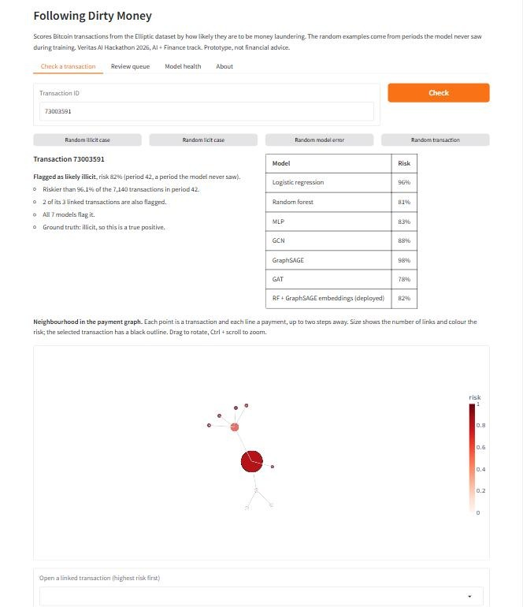
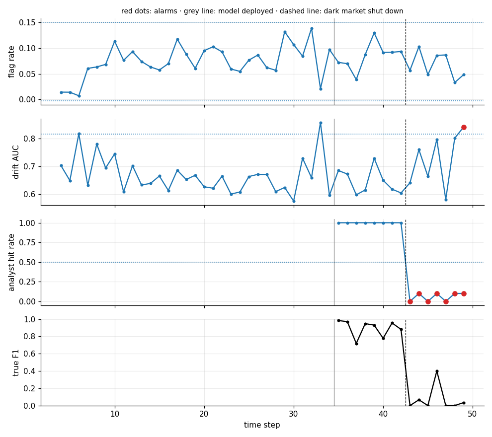

# Following Dirty Money

**Track:** Finance · **Team:** solo entry

Catching Bitcoin money laundering with graph neural networks, and noticing, without waiting months for labels, when
criminals change tactics and the model quietly stops working.

> This project is a prototype and is not financial advice.

[Open the notebook in Colab](https://colab.research.google.com/github/sushixodev/following-dirty-money/blob/main/elliptic_aml.ipynb) ·
run the app with `python app.py`

## The problem

Compliance analysts at crypto exchanges decide which incoming transactions to freeze and investigate, but they can only
review a few dozen a day. A missed case can fund ransomware or scams; a wrong freeze locks an innocent person's money.
Models help rank transactions, yet criminals adapt and confirmed labels arrive months later, so a model can break without
anyone noticing.

## What I built

**Input:** a Bitcoin transaction and its neighbourhood in the payment graph. **Output:** a risk score with plain-language
reasons, and a health check that says when the model can no longer be trusted. The app has four views:

- **Check a transaction:** risk score, a short explanation (rank within its period, flagged neighbours, model agreement,
  ground truth), the score of each of the 7 models, and a rotating 3D map of the transaction's neighbourhood that can be
  followed link by link.
- **Review queue:** the riskiest transactions of a chosen period for a given review budget, with the ground truth shown
  on request.
- **Model health:** the three monitoring signals replayed period by period.
- **About:** data, model and limitations, with the numbers read from the notebook's results.

## What I added

I started from the public Elliptic benchmark (Weber et al., 2019), not from one of the suggested projects, reproduced
its models and then asked my own questions:

1. **The analyst's view.** How many launderers does an analyst find with a fixed review budget, not only what is the F1?
2. **Noticing that the model broke.** Around period 43 a dark market shut down and every model stopped working. I compare
   two monitors that need no labels (flag rate, data drift) with one that needs only the ten reviews an analyst does anyway.
3. **Does retraining fix it?** Retraining every period with labels arriving one or four periods late.
4. **Explanations** for every flag, and an app that puts all of it in an analyst's hands.

## How it works

**Data.** Elliptic: 203,769 real Bitcoin transactions, 234,355 payments, 49 periods about two weeks apart; 4,545 labelled
illicit, 42,019 licit, the rest unknown; 165 anonymised features. Payments never cross periods, so a split by time cannot
leak through the graph. Features are standardised with training-period statistics only.

**Split.** Train on periods 1-34, test on 35-49, never shuffled. Network training length is chosen on 30-34 while
training on 1-29. Every model except the two simplest baselines is trained with three seeds and their predictions averaged.

**Models.** Baselines: always "licit", logistic regression, random forest (as in the paper). Networks: MLP (no graph), GCN,
GraphSAGE, GAT. Deployed model: a random forest fed with the raw features plus the 100-number neighbourhood summary of the
graph network that scored best on validation (GraphSAGE).

## Results

Unseen periods 35-49 (16,670 labelled transactions, 6.5% illicit), illicit class:

| Model | Precision | Recall | F1 | PR-AUC |
|---|---|---|---|---|
| Always "licit" (baseline) | 0.000 | 0.000 | 0.000 | 0.065 |
| Logistic regression (baseline) | 0.318 | 0.705 | 0.438 | 0.328 |
| Random forest (baseline from the paper) | 0.917 | 0.723 | 0.808 | 0.782 |
| MLP, no graph | 0.611 | 0.558 | 0.583 | 0.545 |
| GCN | 0.789 | 0.498 | 0.610 | 0.634 |
| GraphSAGE | 0.708 | 0.596 | 0.648 | 0.682 |
| GAT | 0.681 | 0.416 | 0.517 | 0.570 |
| **Random forest + GraphSAGE embeddings** | **0.972** | 0.716 | **0.824** | **0.784** |

- **My baseline scored 0.808 F1 (random forest); my model scored 0.824 on held-out data**, and 97% of its flags are truly
  illicit (single seeds vary by ±0.001). The graph helps networks (GraphSAGE 0.65 vs 0.58 without it), but on its own a
  graph network still loses to a random forest, as in the paper. Combining them works best.
- **For the analyst:** reviewing the 50 riskiest transactions per period finds **376 of 1,083** launderers; 50 random
  reviews per period find about 51.
- **Where it fails, part 1: the dark market shutdown.** From period 43 F1 falls from 0.90 to 0.07, for every model alike,
  and *silently*: the model keeps flagging as much as before, just the wrong transactions. Retraining with labels one
  period late lifts the random forest only from 0.04 to 0.17 (0.09 with a realistic four-period delay).
- **Where it fails, part 2: good periods.** It misses 142 of 914 launderers (16%). Only 9% of those are linked to a risky
  transaction, the same as licit ones (10%), against 34% of the caught ones: they look ordinary and keep ordinary company.

| Monitor, checked every period | False alarms while it worked (35-42) | First alarm after the break | Alarms during the break (43-49) |
|---|---|---|---|
| Flag rate (no labels) | 0 | none | 0 of 7 |
| Data drift vs the previous 3 periods (no labels) | 0 | period 49 | 1 of 7 |
| **Analyst hit rate on their 10 riskiest reviews** | **0** | **period 43** | **7 of 7** |

**Main takeaway:** anti-money-laundering models can break overnight without any visible sign. Label-free dashboards did
not notice; the outcome of the ten reviews an analyst does anyway did, immediately.

## What I'd do next

1. Turn the hit-rate alarm into action: when it fires, send a random sample of flagged and unflagged transactions to
   investigators and retrain on what they find (active learning) instead of waiting months for labels.
2. Test on Elliptic2 (2024) or the Elliptic++ wallet graph to see whether the silent failure repeats.

## Sources

- **Data:** Elliptic Bitcoin dataset. M. Weber et al., *Anti-Money Laundering in Bitcoin: Experimenting with Graph
  Convolutional Networks for Financial Forensics*, KDD 2019 Workshop on Anomaly Detection in Finance,
  [arXiv:1908.02591](https://arxiv.org/abs/1908.02591); original release on
  [Kaggle](https://www.kaggle.com/datasets/ellipticco/elliptic-data-set), downloaded from the
  [PyTorch Geometric mirror](https://data.pyg.org/datasets/elliptic).
- **Methods:** GCN, Kipf & Welling 2017 ([arXiv:1609.02907](https://arxiv.org/abs/1609.02907)); GraphSAGE, Hamilton et al.
  2017 ([arXiv:1706.02216](https://arxiv.org/abs/1706.02216)); GAT, Veličković et al. 2018
  ([arXiv:1710.10903](https://arxiv.org/abs/1710.10903)); drift detection with a classifier, Lopez-Paz & Oquab 2017
  ([arXiv:1610.06545](https://arxiv.org/abs/1610.06545)) and Rabanser et al. 2019, *Failing Loudly*
  ([arXiv:1810.11953](https://arxiv.org/abs/1810.11953)).
- **Libraries:** [PyTorch](https://pytorch.org), [PyTorch Geometric](https://pyg.org), [scikit-learn](https://scikit-learn.org),
  [pandas](https://pandas.pydata.org), [NumPy](https://numpy.org), [SciPy](https://scipy.org),
  [matplotlib](https://matplotlib.org), [NetworkX](https://networkx.org), [Plotly](https://plotly.com/python/),
  [Gradio](https://www.gradio.app), [pytest](https://pytest.org).
- **AI tools:** [Claude](https://claude.ai) (Anthropic) via Claude Code, used to plan the project, write and debug code and
  draft this write-up. I reviewed every part and can explain it.

## Repository

| Path | What it is |
|---|---|
| `elliptic_aml.ipynb` | The whole analysis with outputs. Runs top to bottom on Colab (GPU optional). |
| `app.py`, `core.py` | The app: interface in `app.py`, all logic in `core.py`. |
| `tests/` | Tests for the app logic, run on every push by GitHub Actions. |
| `artifacts/app_data.npz` | Scores of all models and alarm limits, saved by the notebook for the app. |
| `figures/`, `results/` | Charts and tables produced by the notebook. |

Install with `pip install -r requirements.txt`. Start the app with `python app.py` and run the tests with `pytest`.
To rebuild every result, run `jupyter nbconvert --to notebook --execute --inplace elliptic_aml.ipynb` (downloads 150 MB;
about 10 minutes with a GPU, 45 on CPU only).
